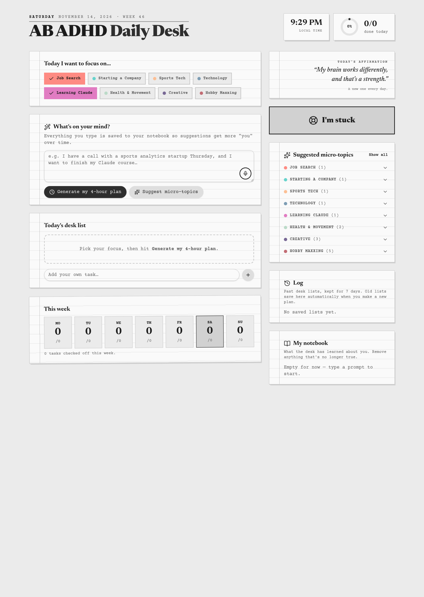
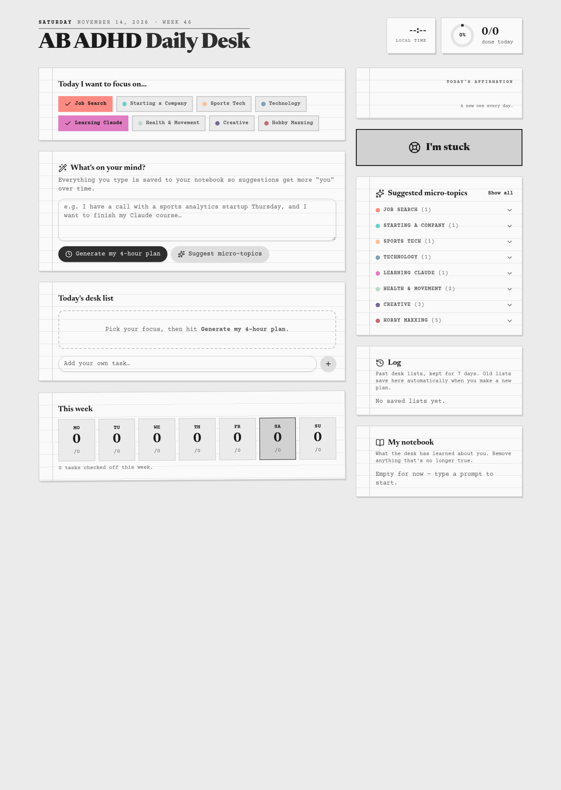

# AB ADHD Daily Desk

A personal morning homepage designed for ADHD brains: pick your focus areas, type (or speak) what's on your mind, and get a manageable, time-blocked plan for your desk session — with checklists built for that dopamine hit when you check things off.

**Live app:** https://adhd-daily-desk.lovable.app



## What it does

- **Focus categories** — eight selectable focus areas (Job Search, Starting a Company, Sports Tech, Technology, Learning Claude, Health & Movement, Creative, Hobby Maxxing), each with its own color that carries through the whole desk.
- **4-hour plan generator** — turns your focus picks and a free-text prompt into a realistic desk plan split into minute-based time blocks, with checkable tasks.
- **Suggested micro-topics** — AI-suggested bite-sized topics per category, each with its own mini checklist. Add them to today's list with one tap, or mark them "Not for me" so future suggestions learn what serves you.
- **"I'm stuck" button** — one tap gets you a gentle nudge and a tiny next-step list when motivation stalls.
- **Speech-to-text prompt** — talk instead of type using the browser's built-in voice input.
- **My notebook** — everything you feed the desk is remembered locally, so suggestions get more "you" over time.
- **This week & Log** — a weekly overview of checked-off tasks and a 7-day log of past desk lists.
- **Daily affirmation, date header, live clock** — notebook-style touches that refresh every day.

All data lives in your browser (localStorage) — no account, no sign-in, nothing leaves your device except the AI prompt.

## Design

A light grayscale ruled-notebook aesthetic — paper sheets, red margin lines, ink strike-throughs on completed tasks — with pastel, tritanomaly-friendly category highlighters. Typography: Newsreader (serif) + Courier Prime (monospace).



## Tech stack

- **React 19 + TypeScript** on **TanStack Start** (SSR, file-based routing, server functions)
- **Vite 7** build tooling
- **Tailwind CSS v4** with custom design tokens and utilities
- **shadcn/ui** components + **lucide-react** icons
- **Google Gemini** (via AI gateway) for plan generation, topic suggestions, and stuck-nudges
- **Web Speech API** for speech-to-text
- **Vitest** for unit tests
- Built and deployed with [Lovable](https://lovable.dev)

## Run locally

```sh
git clone <this-repository-url>
cd <repository-name>
npm i
npm run dev
```

## Tests

```sh
npx vitest run
```
